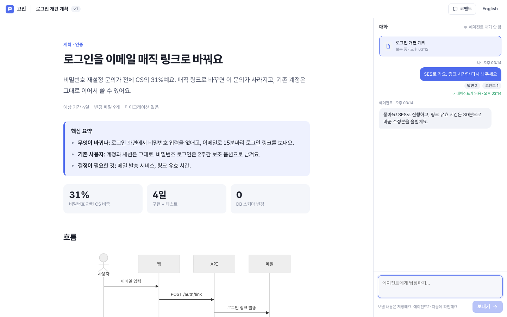
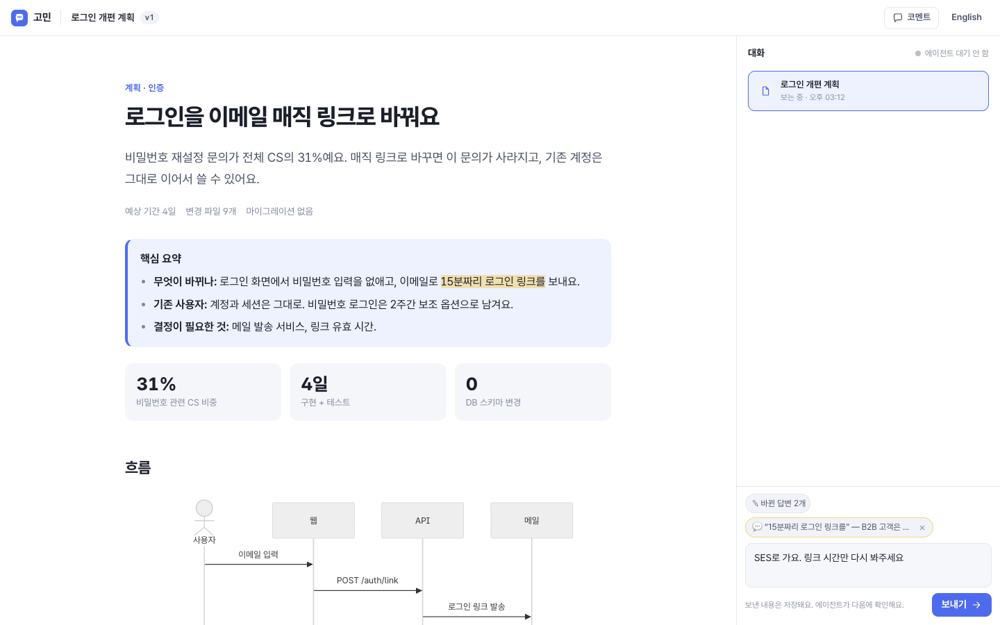
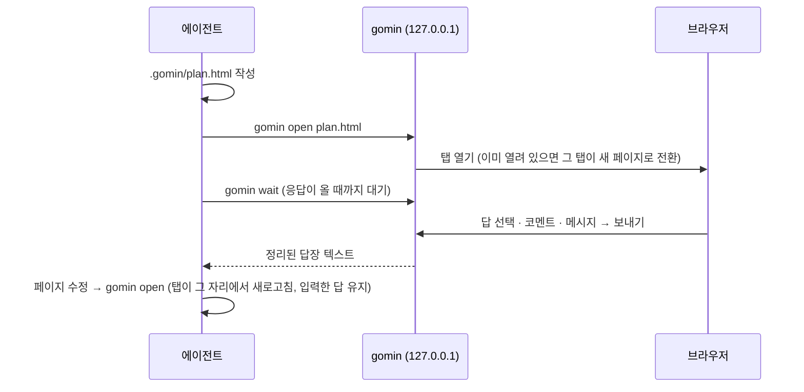

<h1 align="center">고민 · gomin</h1>

<p align="center"><strong>AI 에이전트가 터미널 대신 HTML 페이지로 답하고, 당신의 답을 다시 받아가는 스킬</strong></p>

<p align="center"><a href="README.md">English</a> · 한국어</p>

<p align="center"></p>

긴 계획, 여러 선택지, 표와 다이어그램이 필요한 설명을 채팅창에서 스크롤하며 읽고, "2번은 A로, 3번은 잘 모르겠고…"라고 다시 타이핑하고 있다면 gomin을 써보세요.

에이전트는 HTML 페이지 하나를 쓰고 `gomin open`을 실행합니다. 당신은 브라우저에서 읽고, 선택지를 고르고, 문장이나 요소에 코멘트를 달고, **보내기**를 누릅니다. 에이전트는 `gomin wait`로 그 내용을 깔끔한 텍스트로 받아서 페이지를 고치거나, 새 페이지로 답하거나, 바로 작업을 시작합니다.

- **계획만이 아니라 모든 답변에.** 설명, 비교, 리포트, 코드 리뷰, 질문지까지 하나의 대화 스레드로 이어집니다.
- **폼이 곧 프로토콜.** `name`이 있는 `<input>`, `<select>`, `<textarea>`는 질문 문구와 함께 자동으로 전달돼요. 에이전트가 JS를 쓸 필요가 없습니다.
- **어디에나 코멘트.** 텍스트를 드래그하거나 코멘트 모드에서 요소를 클릭하면 그 위치가 함께 전달됩니다.
- **한국어 우선.** 한국어 UI(영어 전환 가능), Pretendard와 `keep-all` 줄바꿈, 한글 입력(IME) 중에는 Enter로 보내지지 않는 입력창.
- **기본 스타일 킷.** 시맨틱 HTML만 써도 완성도 있는 페이지가 됩니다. 카드, 콜아웃, 선택지, 단계, 표, 다크 모드, Mermaid 자동 렌더링까지. 에이전트의 토큰은 CSS가 아니라 내용에 쓰입니다.
- **로컬 전용, 의존성 0.** Node.js 하나면 됩니다. API 키, 계정, MCP 설정이 필요 없고, 서버는 `127.0.0.1`에서만 열립니다.

## 설치

Node.js 20 이상만 있으면 됩니다. 쓰는 에이전트에 맞는 방법을 하나 고르세요.

### 한 줄로 설치 (추천)

[skills CLI](https://github.com/vercel-labs/skills)가 에이전트별 스킬 폴더에 알맞게 넣어줍니다.

```sh
npx skills add shlee8405/gomin        # 지금 프로젝트에 (어떤 에이전트에 넣을지 물어봐요)
npx skills add shlee8405/gomin -g     # 내 모든 프로젝트에
npx skills add shlee8405/gomin -g -a claude-code codex opencode pi -y   # 에이전트 지정, 확인 생략
```

| 에이전트 | 프로젝트 설치 위치 | 전역 설치 위치 (`-g`) | 직접 부르기 |
| --- | --- | --- | --- |
| Claude Code | `.claude/skills/gomin` | `~/.claude/skills/gomin` | `/gomin 요청` |
| Codex | `.agents/skills/gomin` | `~/.agents/skills/gomin` | `$gomin 요청` |
| OpenCode | `.agents/skills/gomin` | `~/.config/opencode/skills/gomin` | `/gomin 요청` |
| pi | `.agents/skills/gomin` | `~/.agents/skills/gomin` | `/skill:gomin 요청` |

이름을 부르지 않아도 "HTML로 답해줘", "페이지로 보여줘"라고 하거나 선택지와 표가 많은 답변이면 에이전트가 알아서 gomin을 씁니다.

### 에이전트별 다른 방법

- **Claude Code 플러그인:** `/plugin marketplace add shlee8405/gomin` 후 `/plugin install gomin@gomin`. 플러그인으로 설치한 스킬은 `/gomin:gomin`으로 부릅니다.
- **pi 패키지:** `pi install npm:gomin` 또는 `pi install git:github.com/shlee8405/gomin` (이 프로젝트에만 넣으려면 `-l`).
- **CLI만 쓰기:** 셸을 쓸 수 있는 에이전트라면 스킬 없이 npm에서 바로 실행할 수 있어요: `npx -y gomin --help`. 다만 페이지를 잘 쓰는 지침은 스킬에 들어 있으니 스킬 설치를 추천해요.
- **직접 복사:** 저장소를 받은 뒤 `skills/gomin` 폴더를 `~/.agents/skills/`에 복사하세요. Claude Code는 `~/.claude/skills/`에 복사합니다.

### Codex를 쓴다면

Codex의 기본 샌드박스(`workspace-write`)는 localhost 접속까지 막습니다. 그래서 gomin의 로컬 서버가 뜰 수 없어요. 둘 중 하나를 고르세요.

1. 에이전트가 gomin 명령을 샌드박스 밖에서 실행하겠다고 요청하면 승인하세요.
2. 또는 `~/.codex/config.toml`에서 샌드박스 네트워크를 켜두세요. 이렇게 하면 gomin이 샌드박스 안에서 그대로 동작합니다.

```toml
[sandbox_workspace_write]
network_access = true
```

### 확인된 환경

Claude Code 2.1, Codex 0.155, OpenCode 1.18, pi 1.0에서 실제 에이전트가 페이지를 만들고, 열고, 답장을 기다렸다가 받아서 마무리하는 흐름을 확인했어요. 답장이 2분 넘게 늦어도 동작합니다.

## 사용법

에이전트에게 그냥 말하면 됩니다.

```
/gomin 로그인을 매직 링크로 바꾸는 계획 세워줘
고민으로 우리 결제 흐름 설명해줘
이 PR 리뷰 결과 페이지로 보여줘. 고칠지 말지 내가 고를게
```

스킬이 설치되어 있으면 "HTML로 답해줘", "브라우저로 보여줘", "페이지로 정리해줘" 같은 요청이나, 선택지와 표가 많은 답변에서 에이전트가 알아서 gomin을 씁니다.

<p align="center"></p>

페이지에서 고른 답, 코멘트, 메시지는 에이전트에게 이렇게 전달됩니다.

```text
The user replied in gomin.

## Reply · 15:14 · on "로그인 개편 계획" (rev 1)
file: /Users/me/app/.gomin/login-plan.html

Message:
   SES로 가요. 링크 시간만 다시 봐주세요

Answers:
- 메일은 어디로 보낼까요? (mailer): AWS SES [ses]
- 링크 유효 시간 (ttl): 15분 (추천) [15]
- Unanswered: 그 밖에 고려할 점

Comments:
1. On "15분짜리 로그인 링크를" — in "로그인을 이메일 매직 링크로 바꿔요"
   B2B 고객은 메일 확인이 느려요. 30분은 어때요?
```

## 동작 방식



- **대화 스레드:** 작업 폴더마다 스레드가 하나씩 생깁니다. 에이전트가 여는 페이지와 당신의 답장, 에이전트의 짧은 메모(`gomin say`)가 오른쪽 패널에 시간순으로 쌓입니다.
- **수정과 새 페이지:** 같은 파일을 다시 `open`하면 수정본(v2, v3…)이 되고, 다른 파일을 열면 새 페이지가 됩니다. 이전 페이지는 패널에서 언제든 다시 볼 수 있어요.
- **읽음 표시와 대기 상태:** 에이전트가 기다리고 있는지, 보낸 답장을 읽었는지 패널에 표시됩니다. 에이전트가 기다리지 않을 때 보낸 답장도 저장되어 다음 `wait`에서 전달됩니다.
- **샌드박스:** 에이전트가 쓴 페이지는 별도 출처(opaque origin)의 iframe에서 실행됩니다. gomin API나 다른 로컬 서비스에 접근할 수 없습니다.

## CLI

스킬은 번들된 스크립트를 `node <skill-dir>/scripts/gomin.mjs`로 실행합니다.

| 명령 | 설명 |
| --- | --- |
| `open <file.html>` | 페이지를 엽니다. 같은 파일이면 수정본으로 처리됩니다. `--title`, `--no-open`, `--thread` |
| `wait` | 사용자가 보낼 때까지 기다렸다가 답장을 출력합니다. `--timeout <초>`, `--json` |
| `say "<text>"` | 대화 패널에 짧은 메모를 남깁니다. |
| `status` | 스레드, 페이지, 최근 답장을 보여줍니다. `--json` |
| `list` | 스레드 목록 |
| `export <file.html>` | 스타일을 인라인한 단독 HTML을 만듭니다(공유용). |
| `stop` | 백그라운드 서버를 끕니다. 30분 동안 아무도 쓰지 않으면 알아서 꺼집니다. |

환경 변수: `GOMIN_HOME`(상태 폴더, 기본 `~/.gomin`), `GOMIN_PORT`(기본 4949), `GOMIN_NO_OPEN=1`, `GOMIN_THREAD`, `GOMIN_IDLE_MINUTES`(기본 30, 0이면 끄지 않음).

## 페이지 쓰는 법

에이전트용 가이드는 스킬 안에 있습니다. 사람이 직접 써도 됩니다.

- [`SKILL.md`](skills/gomin/SKILL.md): 언제, 어떻게 쓰는지 (대화 루프, 하네스별 대기 방법)
- [`references/design.md`](skills/gomin/references/design.md): 스타일 킷 컴포넌트, 질문/답 폼 규칙, 다이어그램, 한국어 타이포그래피
- [`references/patterns.md`](skills/gomin/references/patterns.md): 설명, 계획 승인, 비교, 질문지, 리포트, 코드 리뷰, 분류 패턴
- [`examples/`](examples): `plan-ko.html`(한국어 계획), `explain-en.html`(영어 설명)

```sh
npm run demo   # examples/plan-ko.html을 브라우저로 열어봅니다
```

## 개발

```sh
npm test        # 단위 + CLI/서버 엔드투엔드 테스트
npm run check   # 문법 검사
GOMIN_DEV=1 node skills/gomin/scripts/gomin.mjs serve   # UI 파일을 요청마다 다시 읽는 개발 모드
```

```
skills/gomin/
  SKILL.md              에이전트 지침
  references/           디자인 · 패턴 가이드
  assets/template.html  시작 템플릿
  scripts/gomin.mjs     CLI
  scripts/lib/          서버, 스레드 저장소, HTML 주입, 답장 포맷
  scripts/ui/           브라우저 셸, 페이지 브리지, 스타일 킷
```

런타임 의존성은 없고, Node.js 표준 라이브러리만 씁니다.

## 감사의 말

에이전트가 쓴 HTML을 사람이 검토하는 흐름은 [lavish-axi](https://github.com/kunchenguid/lavish-axi)에서 영감을 받았습니다. gomin은 검토를 넘어 일상적인 답변에 초점을 맞추고, 폼 기반 응답과 한국어 사용 경험을 우선합니다.

## 라이선스

MIT
