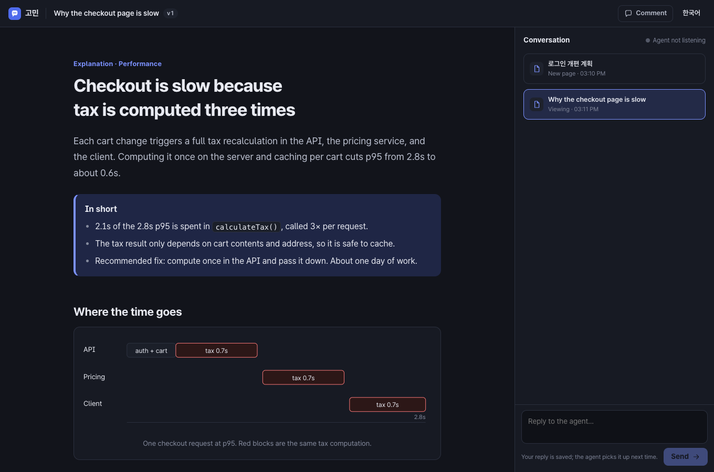
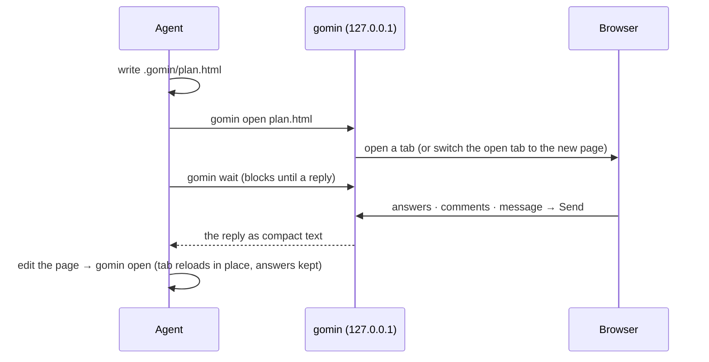

<h1 align="center">gomin · 고민</h1>

<p align="center"><strong>An agent skill that lets your AI answer with an HTML page instead of a wall of terminal text, and brings your answers back.</strong></p>

<p align="center">English · <a href="README.ko.md">한국어</a></p>

<p align="center"></p>

Long plans, several options, explanations that need a table or a diagram: in chat you scroll, then type back "use A for #2, not sure about #3…". With gomin your agent writes one HTML page and runs `gomin open`. You read it in the browser, pick answers, comment on any sentence or element, and press **Send**. `gomin wait` hands the agent everything as compact text. It then revises the page, answers with a new one, or gets to work.

*Gomin* (고민) is Korean for "thinking something over".

- **For any response, not just plans.** Explanations, comparisons, reports, code reviews, and questionnaires all live in one conversation thread.
- **Forms are the protocol.** Every `<input>`, `<select>`, and `<textarea>` with a `name` is sent back with its question text. The agent writes no JavaScript.
- **Comment on anything.** Select text, or click an element in comment mode; the reply says exactly what you pointed at.
- **Live in the page.** Ask follow-ups, comment, or pick options in the page, and the agent answers right there (Markdown messages or updated pages) and keeps listening until you press **End**. No going back to the terminal to say "I replied".
- **Speaks your language.** Pages and the UI follow the language you write in: English stays English, Korean stays Korean. Korean gets first-class care: Pretendard, `keep-all` line breaking, and a composer that never sends mid-IME-composition.
- **Built-in style kit.** Semantic HTML already looks finished: cards, callouts, choice cards, steps, tables, dark mode, and automatic Mermaid. The agent spends tokens on content, not CSS.
- **Local and dependency-free.** Only Node.js is needed: no API keys, accounts, or MCP setup. The server listens on `127.0.0.1` only.

## Install

You need Node.js 20+. Pick the method for your agent.

### One command (recommended)

The [skills CLI](https://github.com/vercel-labs/skills) puts the skill where each agent looks for it.

```sh
npx skills add shlee8405/gomin        # this project (asks which agents)
npx skills add shlee8405/gomin -g     # all your projects
npx skills add shlee8405/gomin -g -a claude-code codex opencode pi -y   # pick agents, no prompts
```

| Agent | Project install | Global install (`-g`) | Invoke explicitly |
| --- | --- | --- | --- |
| Claude Code | `.claude/skills/gomin` | `~/.claude/skills/gomin` | `/gomin <request>` |
| Codex | `.agents/skills/gomin` | `~/.agents/skills/gomin` | `$gomin <request>` |
| OpenCode | `.agents/skills/gomin` | `~/.config/opencode/skills/gomin` | `/gomin <request>` |
| pi | `.agents/skills/gomin` | `~/.agents/skills/gomin` | `/skill:gomin <request>` |

You don't have to name it. Ask for an answer "as a page" or "in HTML", or ask something with many options and tables, and the agent picks gomin up on its own.

### Agent-specific alternatives

- **Claude Code plugin:** `/plugin marketplace add shlee8405/gomin`, then `/plugin install gomin@gomin`. Plugin skills are invoked as `/gomin:gomin`.
- **pi package:** `pi install npm:gomin`, or `pi install git:github.com/shlee8405/gomin` (add `-l` for this project only).
- **Just the CLI:** any agent with a shell can run it from npm without installing the skill: `npx -y gomin --help`. The skill adds the page-writing guidance, so prefer installing it.
- **Manual:** clone the repo and copy `skills/gomin` into `~/.agents/skills/`. For Claude Code, use `~/.claude/skills/`.

### Using Codex?

Codex's default sandbox (`workspace-write`) blocks even localhost connections, so gomin's local server cannot start. Either:

1. approve when the agent asks to run gomin commands outside the sandbox, or
2. enable sandbox networking in `~/.codex/config.toml`, and gomin then runs inside the sandbox as is:

```toml
[sandbox_workspace_write]
network_access = true
```

### Tested with

A real agent wrote a page, opened it, waited for the reply, and finished the task in Claude Code 2.1, Codex 0.155, OpenCode 1.18, and pi 1.0. This also works when the reply takes more than two minutes.

## Use

Just ask:

```
/gomin plan the move to magic-link login
use gomin to explain how our checkout works
show me this PR review as a page — I'll decide what to fix
```

With the skill installed, the agent also reaches for gomin by itself when you ask for an HTML answer or when a response is full of options, tables, and decisions.

What the agent receives after you press Send:

```text
The user replied in gomin.

## Reply · 15:14 · on "Why the checkout page is slow" (rev 1)
file: /Users/me/shop/.gomin/checkout.html

Message:
   Go with the API fix, but keep the old path behind a flag.

Answers:
- Which fix should I implement? (fix): Compute once in API [api-once]

Comments:
1. On "cuts p95 from 2.8s to about 0.6s" — in "Checkout is slow because tax is computed three times"
   Is that measured or estimated?

Clicked: Go ahead [decision=go]
```

## How it works



- **Threads:** each working directory gets a conversation thread. Pages, your replies, and the agent's short notes (`gomin say`) stack up in the side panel.
- **Revisions and new pages:** re-opening the same file makes a revision (v2, v3…); opening another file adds a page. Earlier pages stay one click away.
- **Presence and receipts:** the panel shows whether the agent is listening and when it read your reply. Replies sent while it isn't listening are kept for the next `wait`.
- **Sandbox:** pages run in an opaque-origin iframe and cannot reach the gomin API or other local services.

## CLI

The skill runs the bundled script as `node <skill-dir>/scripts/gomin.mjs`.

| Command | What it does |
| --- | --- |
| `open <file.html>` | Show a page; the same file again is a revision. `--title`, `--no-open`, `--thread` |
| `wait` | Block until the user sends, then print the reply. `--timeout <sec>`, `--json` |
| `say` | Answer in the conversation panel, as Markdown read from stdin (`gomin say <<'EOF' … EOF`) or `--file answer.md` |
| `status` | Thread, pages, and recent replies. `--json` |
| `list` | List threads |
| `export <file.html>` | Write a standalone copy with styles inlined, for sharing |
| `stop` | Stop the background server (it also exits after 30 idle minutes) |

Environment: `GOMIN_HOME` (state dir, default `~/.gomin`), `GOMIN_PORT` (default 4949), `GOMIN_NO_OPEN=1`, `GOMIN_THREAD`, `GOMIN_IDLE_MINUTES` (default 30; 0 = never).

## Writing pages

The agent-facing guides ship with the skill and work for humans too:

- [`SKILL.md`](skills/gomin/SKILL.md): when and how to use gomin (the loop, waiting in each harness)
- [`references/design.md`](skills/gomin/references/design.md): kit components, form rules, diagrams, Korean typography
- [`references/patterns.md`](skills/gomin/references/patterns.md): explanation, plan approval, comparison, questionnaire, report, code review, triage
- [`examples/`](examples): `plan-ko.html` (Korean plan), `explain-en.html` (English explanation)

```sh
npm run demo   # opens examples/plan-ko.html in your browser
```

## Development

```sh
npm test        # unit tests plus CLI/server end-to-end tests
npm run check   # syntax check
GOMIN_DEV=1 node skills/gomin/scripts/gomin.mjs serve   # dev mode: re-read UI files on every request
```

No runtime dependencies, only the Node.js standard library.

## Credits

The review loop for agent-written HTML is inspired by [lavish-axi](https://github.com/kunchenguid/lavish-axi). gomin focuses on everyday answers rather than artifact review, with form-based replies and natural English and Korean support.

## License

MIT
